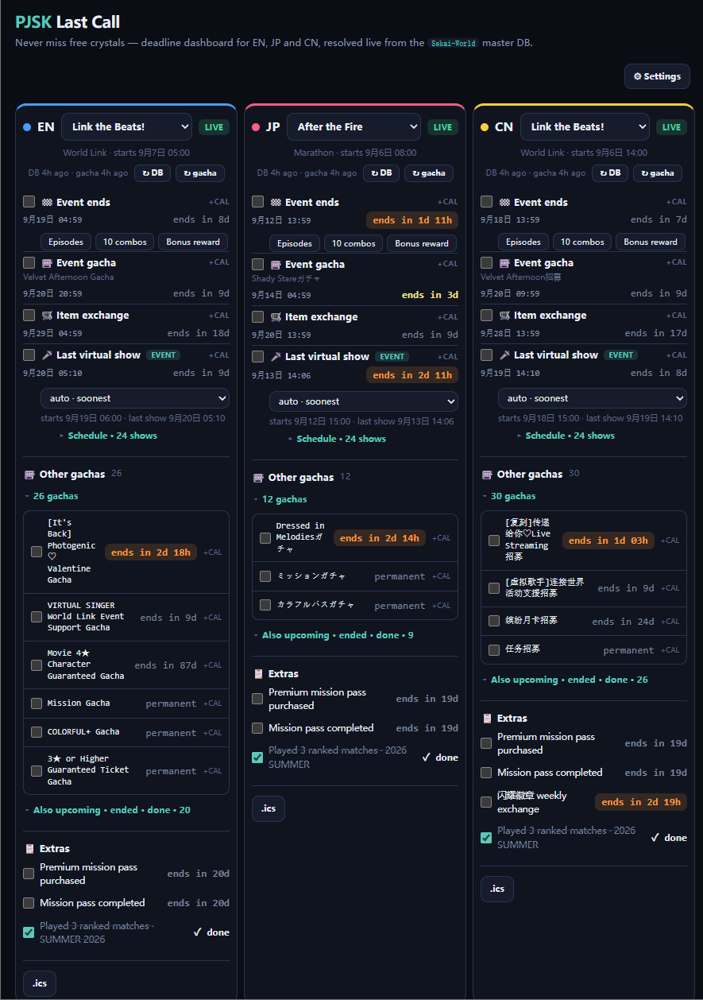
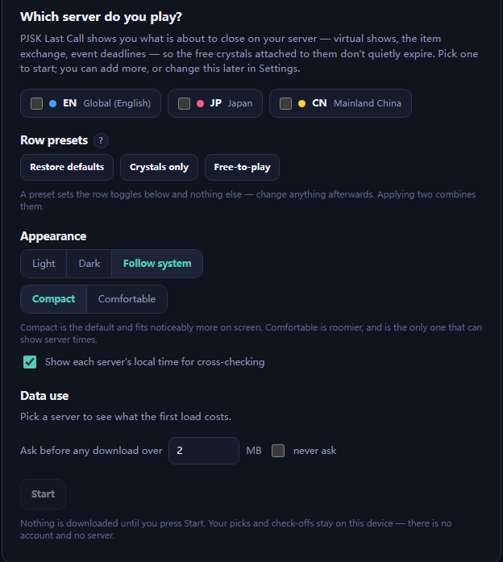

# PJSK Last Call

**Never miss free crystals — a deadline dashboard for Project Sekai, on EN, JP and CN.**

> **AI use declaration:** this is a completely vibe-coded tool. Every part of it — the code, the
> design decisions, this README — was heavily AI-assisted.
>
> **However, it is also actively used by the author**, on desktop, across three servers. Every
> timing rule in it was verified against a live game client, so all core functions should be
> running correctly.

Like any gacha game, crystals are hard to come by. For the author, who for some reason decided to
play three servers at once, collecting all of them is very much a hassle. This tool aims to help
the author — and hopefully you — collect the easy crystals that are prone to expiring, the ones in
virtual shows, item exchanges and event stories, across every server you play, in an
information-dense format.

It is a dashboard you glance at, not a to-do list you process. Tick something off when you have
dealt with it — or when you have decided you do not care — and it stops competing for your
attention until the next event.

## Using it

**Online — <https://ymdsan.github.io/pjsk-last-call/>** — nothing to install.
**Recommended for mobile users.**

**Offline — download `index.html` and open it.** One self-contained file: no dependencies, no build
step, no server. It runs straight from a `file://` path, which makes it easy to keep in a folder,
edit, or carry on a USB stick. Best suited to desktop, and **not recommended on mobile** — opening
a downloaded `.html` file on a phone is awkward, with no clean way to launch it, and most mobile
browsers lose the file once you close the tab or restart the browser, so you end up digging through
your downloads every time.

**Add it to your home screen** (recommended alongside the online version). On iOS: Share → Add to
Home Screen; it then launches full-screen, without browser chrome. On Android: browser menu → Add
to Home screen, which gives you a one-tap shortcut.

> The shortcut still needs a connection to load the page itself. Your cached deadline data survives
> offline, but the page does not yet — **proper offline support is in development.**

On first run it asks which server you play, offers a preset for how much detail you want, lets you
set the theme and density, and shows what the initial download costs. Nothing is fetched before you
answer.

## What it shows

For your current event on each selected server:

- **Event ends** — the grind cutoff, with the sub-tasks that carry crystals: event episodes, the
  10-full-combos mission, and the final bonus reward.
- **Item exchange** — worth at least 500 easily-obtained crystals every event, and the deadline is
  8–10 days later than most people assume.
- **Last virtual show** — the easiest thing to miss. Shows run as a roughly one-day burst, not for
  the whole event.
- **Event gacha** and every concurrent banner, folded away by default.
- **Extras** — the monthly mission pass, both buying it and finishing it, your first three ranked
  matches of the season, and the CN weekly badge exchange.

Every row can be switched off in Settings, and presets set them in one click: **Everything**,
**Crystals only** (hides the gacha rows), or **Free-to-play** (hides the paid mission pass).
Presets combine, and you can save up to three of your own.

## Setting it up

Everything below can be changed later from **⚙ Settings** — nothing here is permanent.

**Servers.** Pick one to start. Each one you add is a separate column that loads independently, so
a server having a bad day never blanks the others. Columns fit as many across as your window
allows and stack when it gets narrow — two servers sit side by side on a fairly small screen, at
the same slim width three would use.

**Row presets.** These decide how much is on screen. The default shows everything; the **?** next
to the heading explains exactly what each preset hides.

- **Restore defaults** — everything visible.
- **Crystals only** — hides the two gacha rows, which are about *spending* crystals rather than
  collecting them. Virtual shows stay, because they pay out crystals or wish pieces either way.
- **Free-to-play** — hides the two mission-pass rows, which assume you bought the pass.

They combine, and every individual row stays switchable afterwards.

**Theme.** Light, dark, or follow your system. Dark is the original; the light palette was rebuilt
from scratch rather than lightened, because the urgency colours stop working on a pale background.

**Density.** *Compact* is the default and fits noticeably more within the same screen real estate;
*Comfortable* is roomier if you prefer the space. Compact is not just tighter spacing — it drops
the server-time line, folds the event sub-tasks into a single row of chips, and shortens countdowns
to the precision that still matters: seconds under a day, hours under three, days beyond that.

**Server time.** Shows each server's own local clock beside your own, which is useful for
double-checking a deadline against what the game itself displays. **Requires Comfortable density** —
compact hides it to save width, and says so when you look for the setting.

**Data.** A refresh is a few hundred kilobytes. Gacha timing is the only large download, and it
only happens when you ask, after a prompt telling you the exact current size. You can raise the
threshold or turn the prompt off entirely.

## Reading the screen

Countdowns tick live. Anything within **three days** gets a coloured chip — red under a day, orange
under three — and everything further out stays quiet grey text. The chip is the signal: if you see
one, something needs attention soon.

Tick a row when you have dealt with it, or when you have decided you do not care. It greys out and
stops competing for attention. Check-offs are keyed to the specific event, season or month, so they
clear themselves when the next one starts. Once every row for an event is ticked, the tool offers
to move you to the next event.

## Things worth knowing

**Event and gacha names appear in the server's own language.** A JP event shows its Japanese name,
because that is what your game client shows you. This is deliberate — matching your client is the
point, and translating it would make cross-checking harder.

**Data use is small, and it tells you before it isn't.** A full refresh is a few hundred kilobytes.
Gacha timing is the only large download — about 2.8 MB on EN, 3.4 MB on JP, 322 KB on CN — and it
only happens when you ask for it, after a prompt showing the exact current size. You can set the
threshold, or turn the prompt off, in Settings.

**Everything stays on your device.** There is no account, no server, no analytics. Your settings
and check-offs live in your browser's local storage, which also means they do not sync between
devices, and clearing site data clears them.

**v1 covers EN, JP and CN.** TW and KR mirrors exist and the code is ready for them, but every
timing rule here was verified against a live client, and the author does not play those two. They
will be added once the details can be confirmed rather than guessed.

## Feedback

**[Send feedback — no account needed](https://forms.gle/6v2fyvQp7VQJujkE6)**. That is the main
channel, and the form is deliberately login-free so anyone can use it.

If you do have a GitHub account, [Issues](https://github.com/YMDSan/pjsk-last-call/issues) work
too and are easier to have a back-and-forth in. Either is fine — bug reports, wrong times, missing
deadlines, and "this was confusing" are all useful.

## Data source

Timing data comes from the community-maintained [Sekai-World](https://github.com/Sekai-World)
master-database mirrors, fetched directly by your browser at runtime. This project does not
redistribute game data, and is enormously indebted to that project for keeping the mirrors current.

## Roadmap

- **TW and KR servers.** The mirrors exist and the code is ready for them; what is missing is
  verification against a live client, which needs someone who actually plays them.
- **Crystal amounts per task**, so each row says what it is worth rather than only when it closes.
- **Works offline once installed.** Cached deadline data already survives with no connection, but
  the page itself still needs one to load.
- **More interface languages.** The groundwork is done — every string is already in one table, so
  adding a language is translation work rather than code work.
- **Opening up contributions**, including publishing the test suite and the design notes that
  explain why several "obvious" data choices here are wrong.

## Development

The tool is `index.html` — one file, vanilla JS and CSS, no build step and no dependencies. That is
a hard constraint rather than an accident: it is what lets it run straight from a `file://` URL with
no server, and keep working offline.

There is a jsdom test suite covering the parts that are easy to get quietly wrong — the DST-exact
server-day maths, the verified field mappings, the check-off behaviour — but it is not published
yet. Until it is, the feedback form and Issues are the best way to report something.

## Licence

[MIT](LICENSE) for the code.

---

**Unofficial fan project.** PJSK Last Call is not affiliated with, endorsed by, or sponsored by
SEGA Corporation, Colorful Palette Inc., or Crypton Future Media. *Project SEKAI COLORFUL STAGE!
feat. Hatsune Miku* and all related names, characters, and assets are trademarks of their
respective owners. This tool displays scheduling data fetched at runtime from the
community-maintained [Sekai-World](https://github.com/Sekai-World) master-database mirrors; it
does not redistribute game data or assets.
